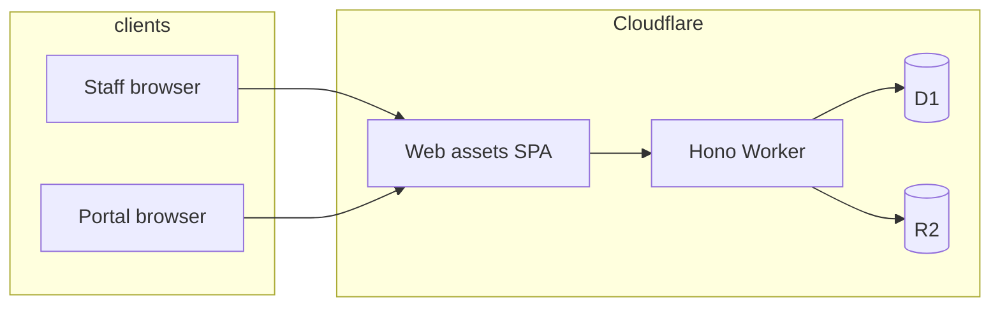
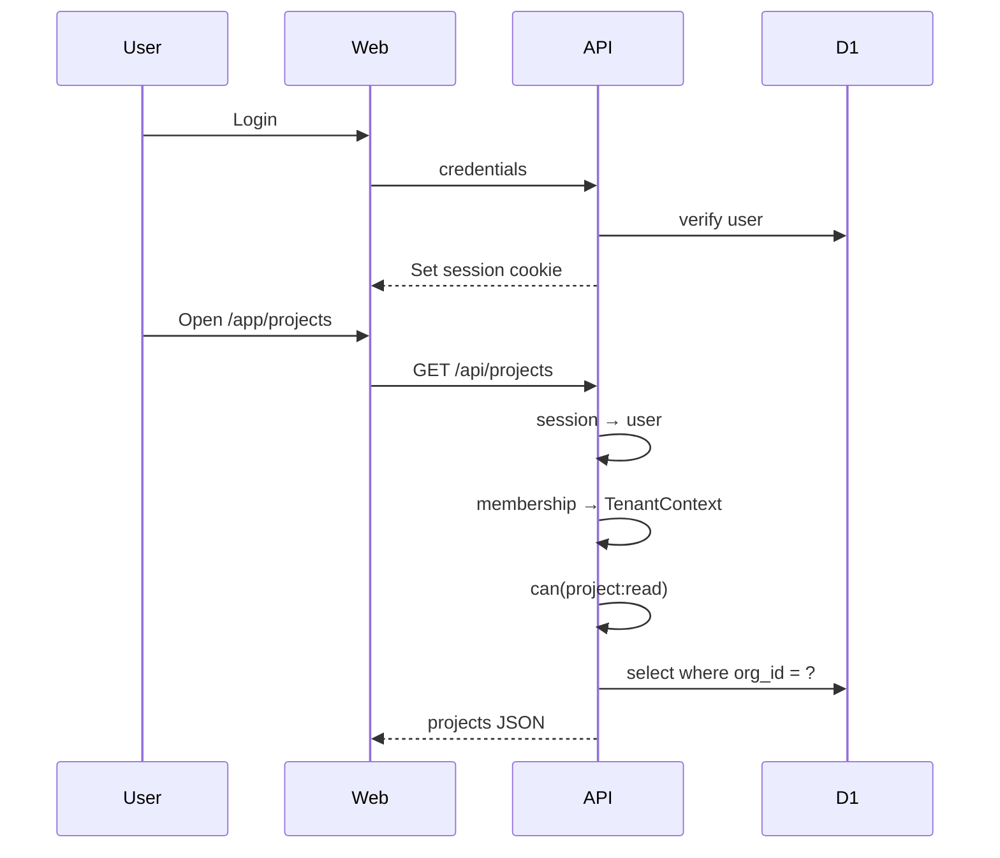

# Tavelle — System Architecture (Phase 0)

**Status:** Phase 0 decisions locked (2026-11-26, Australia/Brisbane)  
**Related:** [ADR-001](./decisions/ADR-001-technology-stack.md) (ACCEPTED), [MODULES.md](./MODULES.md), [SECURITY.md](./SECURITY.md)

---

## 1. Locked foundation

| Layer | Choice | Rationale |
|-------|--------|-----------|
| UI | React 19 + TypeScript + Vite SPA | Mature, excellent AI-assisted DX, clear separation from API |
| API | Hono on Cloudflare Workers | Tiny, typed, first-class Workers support |
| DB | Cloudflare D1 (SQLite) + Drizzle ORM | Low ops, SQL portability, solid local emulator story |
| Files | Cloudflare R2 | S3-compatible, cheap, same vendor |
| Validation | Zod (shared contracts package) | Runtime + types; explicit contracts |
| Auth | **Better Auth** (spike Phase 1); fallback Auth.js/custom only if spike fails | ACCEPTED; magic link **and** password for v1 |
| Currency | **AUD only** to start (when financials ship) | Locked 2026-11-26 |
| Tenancy ops | Invite-only org provisioning (Phases 1–4); multi-tenant schema | Locked 2026-11-26 |
| Monorepo | pnpm workspaces + lightweight Turborepo (optional) | Clone-and-run; shared contracts |
| CI | GitHub Actions | Lint, typecheck, test, deploy preview |
| Deploy | **Cloudflare** Workers + D1 + R2 (+ Pages / static assets) | **Confirmed** |

**Not recommended now:** Next.js full-stack on Cloudflare (compatibility churn), Prisma on D1 (weaker fit than Drizzle), microservices, Redis/queues, Kubernetes, paid auth SaaS as a hard dependency.

---

## 2. High-level system view



One SPA serves **business** and **portal** experiences via route prefixes (`/app/*`, `/portal/*`) and shell-level auth gates. Same API origin (or configured API subdomain) with cookie/session auth.

---

## 3. Runtime topology

### 3.1 Modular monolith API

Single Worker process registers module routes:

```
/api/health
/api/auth/*
/api/orgs/*
/api/clients/*
/api/projects/*
/api/tasks/*
/api/portal/*
…
```

Middleware chain (order matters):

1. Request ID / logging  
2. Parse session → `UserContext`  
3. Resolve tenant → `TenantContext` (from membership + active org cookie/header **validated server-side**)  
4. Permission helper attached  
5. Route handlers  

### 3.2 Tenant context

```ts
// Conceptual — not implementation
type TenantContext = {
  orgId: string
  actorUserId: string
  actorKind: 'staff' | 'portal'
  roles: string[]
  clientId?: string // required when actorKind === 'portal'
}
```

**Rule:** handlers never trust `body.orgId` as authorization. Switching org requires a membership check and then sets a signed/httpOnly active-org indicator.

See [ADR-003](./decisions/ADR-003-tenant-isolation.md).

### 3.3 Frontend architecture (no visual design in Phase 0)

- **Shell:** auth session bootstrap, org switcher (staff), branding tokens injection point  
- **Business experience:** `/app/...`  
- **Portal experience:** `/portal/...`  
- **Contracts:** import types/schemas from `packages/contracts`  
- **Data access:** thin API client; no direct D1  
- **Branding hooks:** CSS variables populated from `org_branding` — values TBD later; hooks exist  

Avoid SSR for MVP unless SEO for marketing site is required; marketing can be static later.

---

## 4. Repository structure (proposed)

```
tavelle/
  apps/
    web/                 # Vite React SPA
    api/                 # Hono Worker
  packages/
    contracts/           # Zod schemas + shared types
    db/                  # Drizzle schema, migrations, client factory
    config/              # eslint, tsconfig bases
  tooling/
    scripts/             # seed, reset-local
  .github/workflows/
  README.md
  pnpm-workspace.yaml
```

Module code may live in `apps/api/src/modules/*` initially; extract to `packages/modules/*` only if reuse or clear boundaries demand it.

---

## 5. Local development vs Cloudflare

| Concern | Local | Cloudflare |
|---------|-------|------------|
| API | Wrangler dev (Worker) | Workers |
| DB | Miniflare/Wrangler D1 local | D1 |
| R2 | Local R2 simulation / filesystem fallback | R2 |
| Web | Vite dev server + proxy to API | Pages / asset binding |
| Secrets | `.dev.vars` (gitignored) | Worker secrets |

**Goal:** `pnpm i && pnpm dev` brings up web + api + local D1 migrations applied.

Details: [DEVELOPMENT.md](./DEVELOPMENT.md).

---

## 6. AuthN / AuthZ architecture

### AuthN

- **Magic link and password** for v1 (staff and portal as appropriate)  
- Better Auth on Workers + D1 (Phase 1 spike)  
- Session cookies: `Secure`, `HttpOnly`, `SameSite=Lax` (or `None` only if cross-site API — prefer same-site)  
- Email verification before sensitive actions (configurable)  
- Org creation: **invite/admin gated** — no public self-serve org signup in Phases 1–4  

### AuthZ

- Role → permissions map (RBAC)  
- Resource checks include **org_id** and, for portal, **client_id**  
- Optional ABAC later (record ownership); not required for MVP  



---

## 7. Documents and files

- Upload: API issues **presigned R2 URL** or streams via Worker (size-limited)  
- Metadata row in `documents` with `org_id`, visibility (`staff` | `portal` | `specific`)  
- Virus scanning: **before real customer docs in production** (see SECURITY.md) — can stub in Phase 5  

---

## 8. AI placement (future)

AI features call out from application services **after** permission checks, never as the source of truth. Suggested later surfaces: summarising activity, drafting proposal text. **Not** in MVP architecture critical path.

---

## 9. Alternatives considered (system level)

| Option | Trade-off |
|--------|-----------|
| Next.js / Remix full-stack | Faster “one app”; worse Cloudflare footguns; blurrier module boundaries |
| Node on Fly/Railway + Postgres | Excellent DX; higher baseline cost/ops vs Workers+D1 |
| Separate portal codebase | Cleaner UX isolation; doubles auth/contract drift for a solo founder |
| DB-per-tenant | Strong isolation; migration and wrangler complexity too early |

### Deferrable / reversible

- Moving API from Workers → Node: **possible** if Drizzle schema stays SQL-standard  
- Splitting web into two apps: **easy** later if route modules stay clean  
- Introducing queues (Cloudflare Queues) for email: **when** outbound volume needs it; sync email send OK at first  

---

## 10. What this architecture deliberately is not

- Not a microservices mesh  
- Not an event-sourced system  
- Not a Dispatch Sites digital twin (DS = branded org via config)  
- Not an AI-native CRM  

It is the **smallest viable multi-tenant modular foundation** that can grow into white-label without a rewrite. Phase 1 setup (GitHub repo, Cloudflare account, domain timing) is operational, not architectural.
