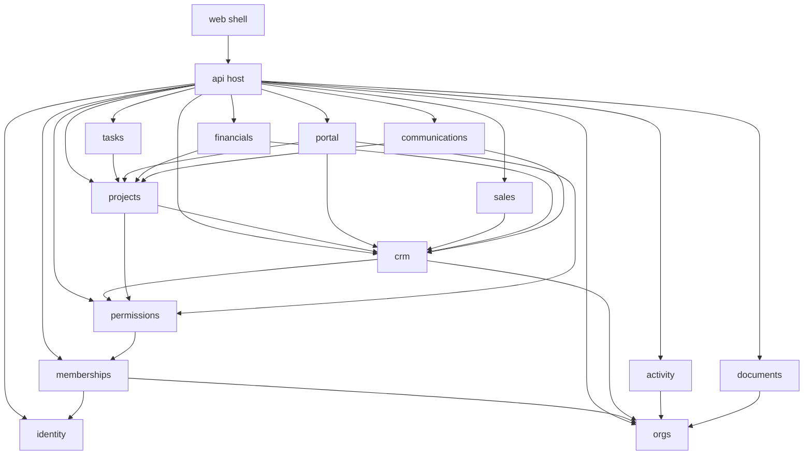

# Tavelle — Module Boundaries (Phase 0)

**Status:** Phase 0 decisions locked (2026-11-26, Australia/Brisbane)  
**Related ADR:** [ADR-002-module-boundaries.md](./decisions/ADR-002-module-boundaries.md) (ACCEPTED)

---

## 1. Approach

**Modular monolith:** one deployable API, one React app (two experiences inside one shell), modules as **folders with rules**, not separate services.

Each module owns:

- Domain types and Zod contracts  
- Persistence (tables / Drizzle schema slice)  
- Application services (use-cases)  
- HTTP routes (registered into the Hono app)  
- Permission checks for its resources  

Modules do **not** own:

- Raw SQL against another module’s tables (go through that module’s public API / service)  
- Cross-cutting auth session creation (identity owns that)  
- Tenant resolution (orgs/tenancy + identity collaborate; see SECURITY / ADR-003)

---

## 2. Module catalogue

| Module | Responsibility | MVP? |
|--------|----------------|------|
| **identity** | AuthN (Better Auth), sessions, credentials, **password and magic-link**, user records | Yes |
| **orgs** | Organisations (invite-only create), tenancy context, branding config hooks (how Dispatch Sites appears), org settings | Yes |
| **memberships** | User↔org membership, invites (staff) | Yes |
| **permissions** | Roles, permission catalogue, checks (`can(actor, action, resource)`) | Yes |
| **crm** | Clients, contacts, notes attached to clients | Yes |
| **projects** | Projects, milestones, progress summary | Yes |
| **tasks** | Tasks under projects; status; assignment to staff | Yes |
| **portal** | Client invites, portal membership, deliverable approvals surface | Yes |
| **activity** | Append-only activity / audit trail for domain actions | Yes (thin) |
| **sales** | Leads, opportunities, proposals/quotes | Later |
| **financials** | Invoices, payments, balances | Later |
| **documents** | File metadata + R2 keys; sharing rules | Later (stub hooks early) |
| **communications** | Internal/portal threads, messages | Later |
| **services** | Recurring services / retainers | Later |
| **integrations** | Outbound webhooks, HyperLynx adapters | Later |
| **entitlements** | Plan/module flags per org (white-label packaging) | Later |

`portal` may be a thin façade over `crm` + `projects` + `permissions` rather than a deep domain — keep it small.

---

## 3. Dependency rules

### Allowed direction (high → low depends on)

```
presentation (web)
  → http adapters (api routes)
    → application services (per module)
      → domain types / contracts
      → persistence (own tables)
      → permissions (check)
      → orgs (tenant context)
      → identity (current user)
```

### Hard rules

1. **No upward imports** from `identity` / `orgs` into `financials`, `sales`, etc.  
2. **No cross-module table joins in ad-hoc SQL** outside an approved read-model helper (defer CQRS; allow a single `activity` writer API).  
3. **Tenant context** is required for all org-scoped modules; services receive `TenantContext`, never a bare client-supplied `orgId`.  
4. **`integrations` depends on others; nothing core depends on `integrations`.**  
5. **`entitlements` gates features; domain modules may query “is module X enabled?” only via entitlements API.**  
6. Prefer **function calls** over in-process event buses until volume justifies them. Activity logging is a synchronous call to `activity.record(...)`.

### Dependency sketch



---

## 4. Package / folder mapping (proposed)

See [DEVELOPMENT.md](./DEVELOPMENT.md) for repo tree. Logical layout:

```
packages/modules/<name>/
  contract/     # Zod schemas, exported types
  domain/       # pure helpers if needed
  app/          # use-cases
  infra/        # drizzle repos
  http/         # Hono route registration
```

Early on, this may collapse to `apps/api/src/modules/<name>/` with the same internal shape. **Do not** invent a plugin loader in Phase 1.

---

## 5. Permission catalogue (initial)

Actions are strings scoped by module, e.g.:

- `org:manage`  
- `member:invite`  
- `client:read` / `client:write`  
- `project:read` / `project:write`  
- `task:write`  
- `portal:invite`  
- `document:read` / `document:write`  
- `invoice:read` / `invoice:write` (later)  

**Roles (v1 defaults):**

| Role | Intent |
|------|--------|
| `owner` | Full org control |
| `admin` | Manage members and most resources |
| `member` | Day-to-day CRM/projects |
| `viewer` | Read-only staff |
| `portal_client` | External; client-scoped only |

Custom roles deferred. Role → permission map lives in `permissions` module; seed defaults per org creation.

---

## 6. Why this split is necessary

- Prevents a Dispatch Sites god-module  
- Makes white-label entitlements additive  
- Keeps AI-assisted edits safer (clear ownership of files)  
- Allows extracting a module to a Worker later **if** metrics demand it (reversible direction: split later, don’t start split)

### Alternatives considered

| Alternative | Why not now |
|-------------|-------------|
| Microservices per module | Ops and latency cost; solo founder tax |
| Plugin/extension runtime | Unnecessary abstraction |
| Single `domain/` blob | Becomes unmaintainable; hard tenancy audits |
| Separate portal app/repo | Duplicates auth and contracts; one shell with route gates is enough |

### Deferrable / reversible

- Collapsing `tasks` into `projects` until complexity grows — **yes, reversible**  
- Collapsing `portal` into `crm` — **acceptable for Phase 1–3**; extract when invite/approval flows thicken  
- Extracting `documents` Worker — **defer until R2 + virus scan + size justify**

---

## 7. HyperLynx integration boundary

Future adapters (e.g. Dispatch Sites operational systems) live under `integrations` and call Tavelle module APIs. **None are required before portal MVP.** Core schemas must not require HyperLynx or Dispatch Sites IDs or naming. Optional external reference fields (`external_refs` JSON or link table) are enough when needed. DS appearance is org branding/config only.
