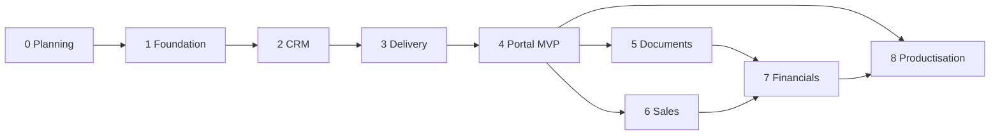

# Tavelle — Phased Implementation Roadmap (Phase 0)

**Status:** Phase 0 decisions locked (2026-11-26, Australia/Brisbane)  
**Constraint:** Phase 0 was planning only — no feature implementation in this pack.

---

## 1. Ordering rationale

Proposed industry-style phasing often puts sales before delivery. For Tavelle’s **smallest genuinely useful product**, delivery + portal trust comes first:

> Account → customer → project → tasks → portal invite → secure client view → relationship hygiene (notes/activity)

Sales pipeline, invoices, and rich communications **amplify** an already working relationship loop; they should not block it.

Challenges to a “sales-first CRM” ordering:

- Dispatch Sites (and most service businesses) feel value when **work is visible**, not when a Kanban lead exists  
- Portal isolation is a security-critical path that needs time to harden  
- Financials without projects/clients create orphan invoices  

---

## 2. Phase map

| Phase | Name | Outcome |
|-------|------|---------|
| **0** | Architecture & product planning | **Done** — decisions locked 2026-11-26 |
| **1** | Foundation | Auth, orgs, memberships, permissions, app shell |
| **2** | CRM core | Clients, contacts, notes |
| **3** | Delivery | Projects, milestones, tasks, progress, activity |
| **4** | Client portal | Invites, secure view, basic relationship loop **← MVP spine complete** |
| **5** | Documents | Upload/download, sharing to portal |
| **6** | Sales | Leads/opportunities, proposals/quotes |
| **7** | Financials | Invoices, payment recording |
| **8** | Scale product | Communications polish, recurring services, branding/white-label hooks, entitlements, integrations |

Phases 5–8 can partially parallelise after Phase 4 if needed; **do not** start 6–7 before portal isolation tests are green.

---

## 3. Phase details & acceptance criteria

### Phase 0 — Planning

**Status:** Complete. PRODUCT, ARCHITECTURE, ADRs 001–003 ACCEPTED; open questions 1–5 locked (see PHASE-0-SUMMARY).

**Before Phase 1 code starts (setup, not architecture):** GitHub repo name/owner, Cloudflare account access, domain timing (optional — previews OK).

---

### Phase 1 — Foundation

**Scope:** identity (Better Auth spike; magic link **and** password), orgs (invite-only provisioning), memberships, permissions, web shell (unstyled functional UI), contracts package, CI skeleton, deploy to Cloudflare preview.

**Acceptance criteria:**

1. Clone-and-run local: migrate D1, start web+api.  
2. User can sign in via **password** and via **magic link**; logout works.  
3. Organisation creation is **invite/admin gated** (no public self-serve org signup); provisioned owner becomes `owner`.  
4. User can invite another staff user (email invite flow stub OK if email provider not wired — token link in logs for local).  
5. Active org switching works for a user in two orgs; API rejects forged org headers/body. Staging seeds ≥2 orgs for isolation proof.  
6. Better Auth spike completed (or fallback recorded by amending ADR-001).  
7. Typecheck + unit tests for permission helper pass in CI.

---

### Phase 2 — CRM core

**Scope:** clients, contacts, client notes.

**Acceptance criteria:**

1. Owner/member can CRUD clients within active org.  
2. Contacts can be added; one primary contact supported.  
3. Cross-tenant client ID access returns 404.  
4. Basic activity events recorded for client create/update.

---

### Phase 3 — Delivery

**Scope:** projects, milestones, tasks, progress summary.

**Acceptance criteria:**

1. Project belongs to a client in-org.  
2. Tasks CRUD with statuses; list by project.  
3. Milestones optional but creatable.  
4. Staff can see simple progress (e.g. counts by status) — not charts.  
5. Viewer role cannot mutate tasks.  
6. Activity feed shows project/task changes.

---

### Phase 4 — Client portal (MVP spine)

**Scope:** portal memberships, invites, portal shell routes, read models for projects/tasks progress, account info.

**Acceptance criteria:**

1. Staff with `portal:invite` can invite a contact email to the portal for a client.  
2. Invitee accepts and lands in `/portal` scoped to that client.  
3. Portal user sees only that client’s projects/progress.  
4. Automated tests prove portal user A cannot read client B in same org, and cannot read other orgs.  
5. Staff continue to manage notes/activity on the client.  
6. SECURITY.md “before any real customer data” checklist items that apply to portal are complete (or explicitly waived with risk acceptance).

**MVP spine is complete at end of Phase 4.**

---

### Phase 5 — Documents

**Acceptance criteria:**

1. Staff upload to R2 with org-prefixed keys + metadata.  
2. Share flag allows portal visibility per document.  
3. Downloads authorized via metadata + tenant context.  
4. Size/type limits enforced.  
5. Malware strategy decided (scan or internal-only gate) before production use.

---

### Phase 6 — Sales

**Acceptance criteria:**

1. Leads/opportunities CRUD in-org.  
2. Convert lead → client (and optionally project) without data loss.  
3. Proposal/quote entity with line items; PDF export can be deferred.  
4. Portal can view shared quotes (if shared).

---

### Phase 7 — Financials

**Acceptance criteria:**

1. Invoices with integer money; **AUD only** for v1 (`currency` column may exist but only `AUD` accepted).  
2. Record payments (manual OK; gateway optional).  
3. Portal can view invoices shared to client.  
4. Permission gates for `invoice:*`.  
5. MFA decision revisited per SECURITY.md.

---

### Phase 8 — Productisation

**Acceptance criteria (pick per slice):**

1. Communications threads between staff and portal.  
2. Recurring services model.  
3. Branding fields drive shell tokens (still may be minimal visually).  
4. Entitlements flags hide modules per org.  
5. Custom domain mapping table + proof on staging.  
6. One HyperLynx integration adapter behind `integrations` (optional).  

---

## 4. Verifiable increments

Each phase should end with:

- Deployed **staging** environment  
- Written acceptance checklist ticked  
- Short demo script (spine happy path grows each phase)  

Avoid multi-month phases; split Phase 8 into vertical slices with their own acceptance.

---

## 5. Dependency graph

Documents before financials is preferred so invoices can attach PDFs later; sales can proceed in parallel with documents after portal.

---

## 6. Explicit out-of-order temptations to resist

| Temptation | Why wait |
|------------|----------|
| Polished UI / design system | Does not validate tenancy or contracts |
| AI features | Must amplify a working core |
| Payment gateway | Manual payment recording first |
| Microservices | No scale signal yet |
| Custom domains | Branding fields first |
